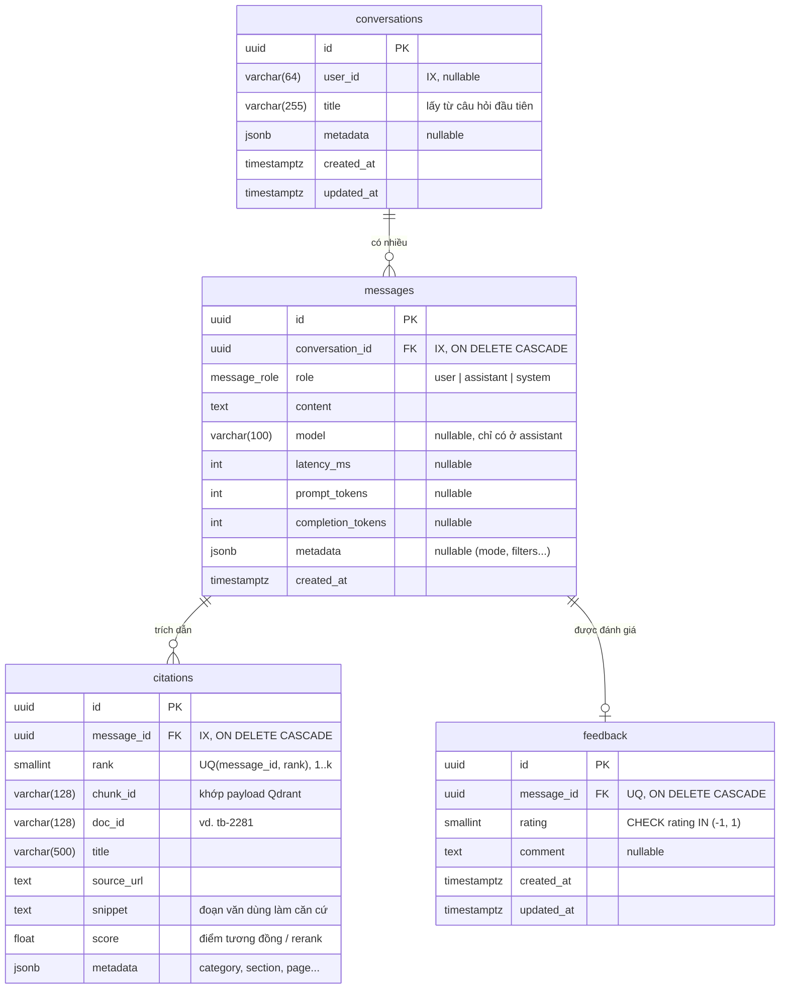

# Sơ đồ cơ sở dữ liệu (T3-07)

4 bảng trong PostgreSQL để lưu lịch sử hỏi đáp, nguồn trích dẫn của từng câu trả lời và đánh giá của sinh viên.

- Nguồn định nghĩa: [`backend/app/db/models.py`](../backend/app/db/models.py)
- Migration tạo bảng: [`backend/alembic/versions/0001_initial.py`](../backend/alembic/versions/0001_initial.py)

## 1. Sơ đồ quan hệ (ERD)



## 2. Giải thích thiết kế

| Bảng | Vì sao thiết kế như vậy |
|---|---|
| `conversations` | Gom các lượt hỏi–đáp của một phiên chat. `user_id` để trống được vì hiện chưa bắt buộc đăng nhập; có thể truyền mã phiên ở trình duyệt. |
| `messages` | Lưu cả câu hỏi (`role='user'`) và câu trả lời (`role='assistant'`). Các cột `model`, `latency_ms`, `prompt_tokens`, `completion_tokens` chuẩn bị sẵn cho Tuần 4 (T4-05 tích hợp LLM) để theo dõi chi phí và tốc độ. |
| `citations` | Mỗi câu trả lời của assistant có 0..k nguồn. `rank` (1, 2, 3...) khớp với ký hiệu `[1]`, `[2]` trong câu trả lời (T4-04). Lưu lại cả `snippet`, `title`, `source_url` tại thời điểm trả lời để dù sau này index lại Qdrant thì lịch sử hội thoại cũ vẫn hiển thị đúng đoạn đã trích. |
| `feedback` | Ràng buộc `UNIQUE(message_id)`: mỗi câu trả lời có một đánh giá; sinh viên bấm lại 👍/👎 thì cập nhật (`rating`: `1` = up, `-1` = down). API chỉ cho phép đánh giá tin nhắn có `role='assistant'`. |

Tất cả khóa ngoại đều có `ON DELETE CASCADE`: xóa một `conversation` sẽ tự xóa `messages`, `citations`, `feedback` thuộc về nó.

## 3. Lệnh làm việc với migration

Chạy trong thư mục `backend/`:

```bash
# Áp dụng mọi migration lên DB hiện tại (container api tự chạy lệnh này khi khởi động)
alembic upgrade head

# Kiểm tra models.py và migration có lệch nhau không
alembic check

# Khi sửa models.py, sinh migration mới
alembic revision --autogenerate -m "mo_ta_thay_doi"
```
